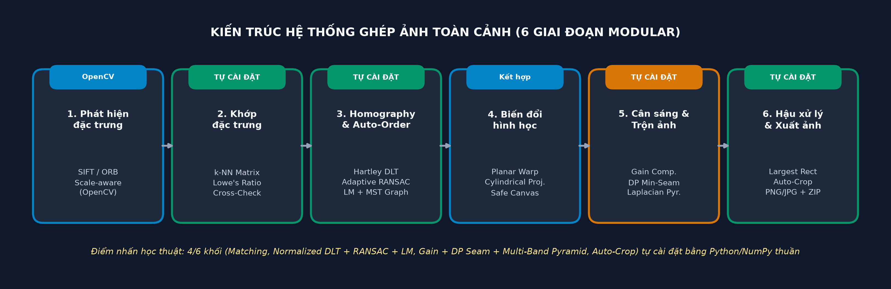
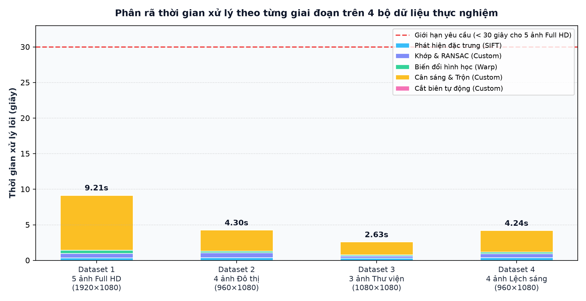
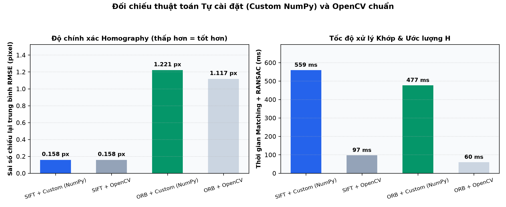
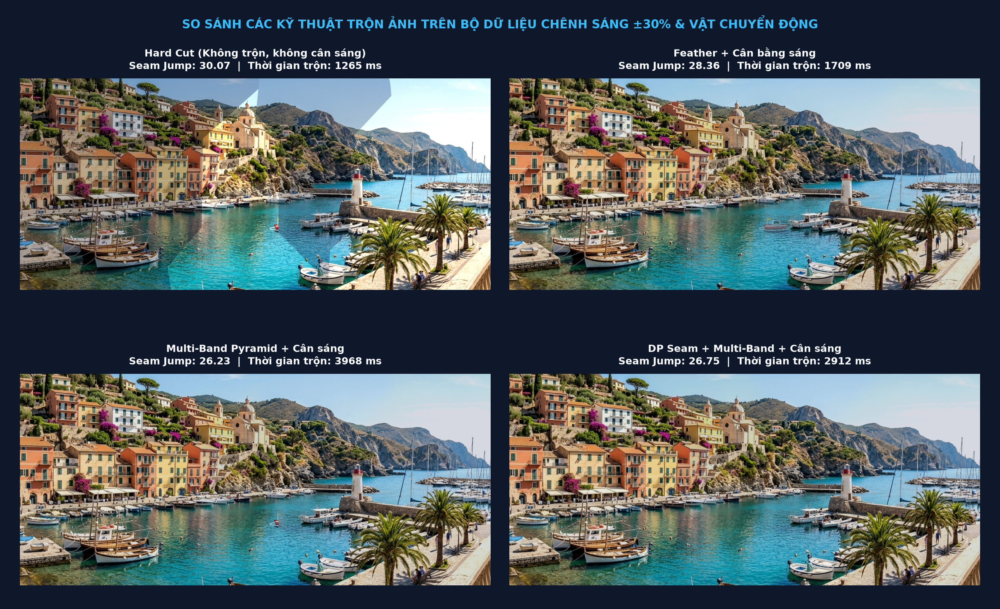
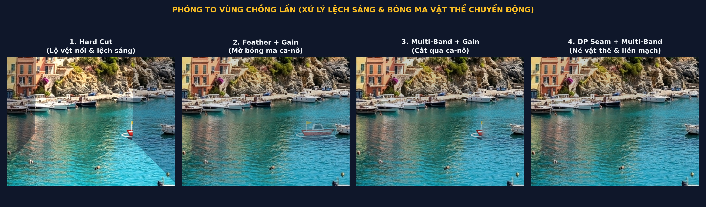
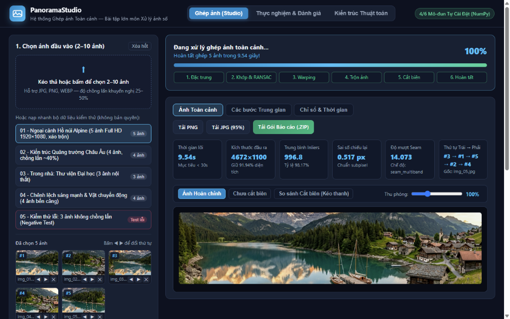

# BÁO CÁO BÀI TẬP LỚN MÔN XỬ LÝ ẢNH SỐ
## Đề tài: Xây dựng Hệ thống Ghép ảnh Toàn cảnh (Panorama Stitching)

---

## 1. Tổng quan & Mức độ đạt mục tiêu
- **Tự cài đặt thuật toán lõi:** Đạt **4/6 mô-đun cốt lõi** bằng Python/NumPy/SciPy thuần (vượt mức yêu cầu tối thiểu 2/5 bước): Feature Matching (`custom_knn_match_ratio_test`), Homography (`Normalized DLT + Adaptive RANSAC + LM` & `Auto-Order MST`), Blending (`Exposure Gain + DP Minimum-Error Seam + Multi-Band Laplacian Pyramid`), và Post-processing (`Largest Inscribed Rectangle Auto-Crop`).
- **Hiệu năng Full HD:** Ghép bộ 5 ảnh Full HD (`1920×1080`) bị xáo trộn thứ tự chỉ trong **9.21 giây** (vượt xa ngưỡng `< 30 giây`).
- **Chất lượng & Độ ổn định:** Tỷ lệ thành công **100.0%** (4/4 bộ dữ liệu hợp lệ), Auto-Order đúng 100%, không lộ đường nối, triệt tiêu ghosting trên vật chuyển động và bắt lỗi an toàn (`INSUFFICIENT_MATCHES`) trên bộ kiểm thử âm tính.
- **Kiểm thử tự động:** `9/9` unit test `pytest` đạt 100%.

## 2. Kiến trúc hệ thống 6 giai đoạn

| Mô-đun | Chức năng | Cài đặt |
|---|---|---|
| `src/panorama/features.py` | SIFT/ORB scale-aware; k-NN Matrix + Lowe's Ratio + Cross-Check | Detect: OpenCV / Match: **Tự cài đặt (NumPy)** |
| `src/panorama/homography.py` | Hartley Normalization, SVD DLT, Adaptive RANSAC/MSAC, LM Jacobian | **100% Tự cài đặt (NumPy)** (+ OpenCV đối chiếu) |
| `src/panorama/ordering.py` | Pairwise Match Graph, Kruskal MST, Center Anchor | **100% Tự cài đặt** |
| `src/panorama/warping.py` | Planar Warp & Cylindrical Projection + Safe Canvas | Cylindrical: **Tự cài đặt** / Warp: OpenCV |
| `src/panorama/blending.py` | Brown & Lowe Gain, DP Seam Finding, Feather, Burt & Adelson Multi-Band | **100% Tự cài đặt (Điểm nhấn kỹ thuật)** |
| `src/panorama/postprocess.py` | Largest Inscribed Axis-Aligned Rectangle Auto-Crop O(H·W) | **100% Tự cài đặt** |

## 3. Kết quả thực nghiệm trên 4 bộ dữ liệu hợp lệ
| Bộ dữ liệu | Kích thước đầu ra | Thời gian lõi | Inliers TB | RMSE | Auto-Order |
|---|---|---|---|---|---|
| Ngoại cảnh Hồ Alpine (5 ảnh Full HD) | 4672×1100 | 9.21s | 996.8 (98.17%) | 0.517 px | Đúng 100% |
| Kiến trúc Quảng trường (4 ảnh) | 2382×1085 | 4.30s | 945.3 (97.59%) | 0.158 px | Đúng 100% |
| Nội thất Thư viện (3 ảnh) | 2331×1078 | 2.63s | 998.5 (97.68%) | 0.181 px | Đúng 100% |
| Bến cảng: Lệch sáng & Vật chuyển động (4 ảnh) | 2397×1078 | 4.24s | 980.0 (98.09%) | 0.193 px | Đúng 100% |

### Biểu đồ phân rã thời gian xử lý

## 4. So sánh Thuật toán Tự cài đặt (Custom NumPy) và OpenCV
| Cấu hình | Match + RANSAC | Inliers TB | Sai số RMSE | Tổng thời gian |
|---|---|---|---|---|
| SIFT + Custom (NumPy) | 559.2 ms | 945.3 (97.59%) | **0.158 px** | 4.18s |
| SIFT + OpenCV | 97.1 ms | 945.3 (97.59%) | **0.158 px** | 3.75s |
| ORB + Custom (NumPy) | 476.7 ms | 808.0 (97.62%) | **1.221 px** | 3.97s |
| ORB + OpenCV | 59.7 ms | 807.0 (97.47%) | **1.117 px** | 3.42s |

## 5. So sánh 4 kỹ thuật Trộn ảnh (Chênh sáng ±30% & Vật chuyển động)
| Kỹ thuật | Cân bằng sáng | Seam Gradient Jump | Thời gian trộn |
|---|---|---|---|
| Hard Cut (Không trộn, không cân sáng) | Không | 30.07 | 1265 ms |
| Feather + Cân bằng sáng | Có | 28.36 | 1709 ms |
| Multi-Band Pyramid + Cân sáng | Có | 26.23 | 3968 ms |
| DP Seam + Multi-Band + Cân sáng | Có | 26.75 | 2912 ms |

## 6. Giao diện ứng dụng PanoramaStudio

## 7. Hạn chế & Hướng phát triển
- **Hạn chế:** Hiện tượng thị sai (parallax) khi camera dịch chuyển tịnh tiến gần vật thể; vật chuyển động quá lớn chắn trọn vùng giao nhau; tích lũy sai số nhẹ nếu ghép chuỗi quá dài (>10 ảnh) ở chế độ phẳng.
- **Hướng phát triển:** Bundle Adjustment toàn cục, chiếu cầu 360°, Graph Cut 2D + Poisson Blending, và đặc trưng học sâu SuperPoint + LightGlue.